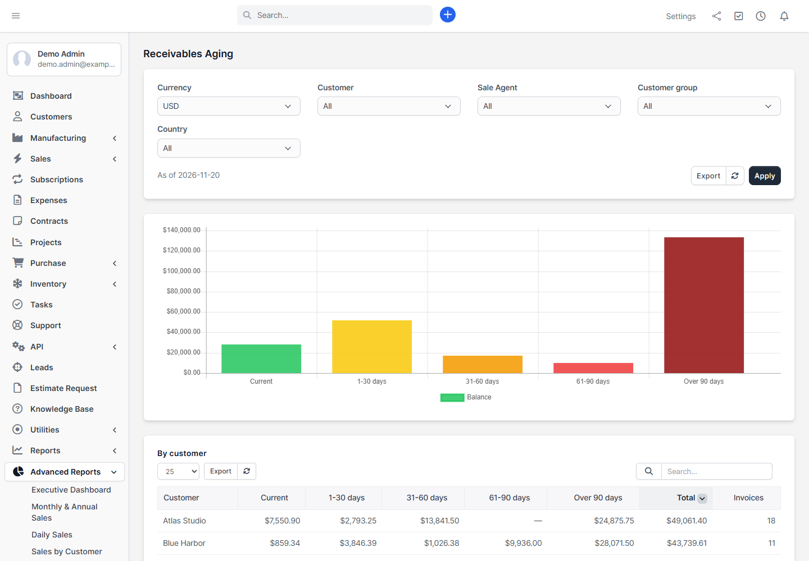
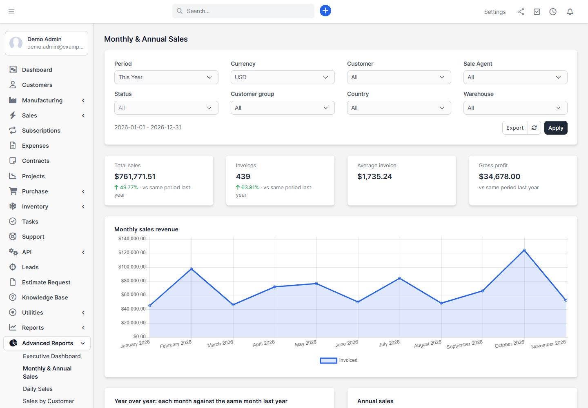
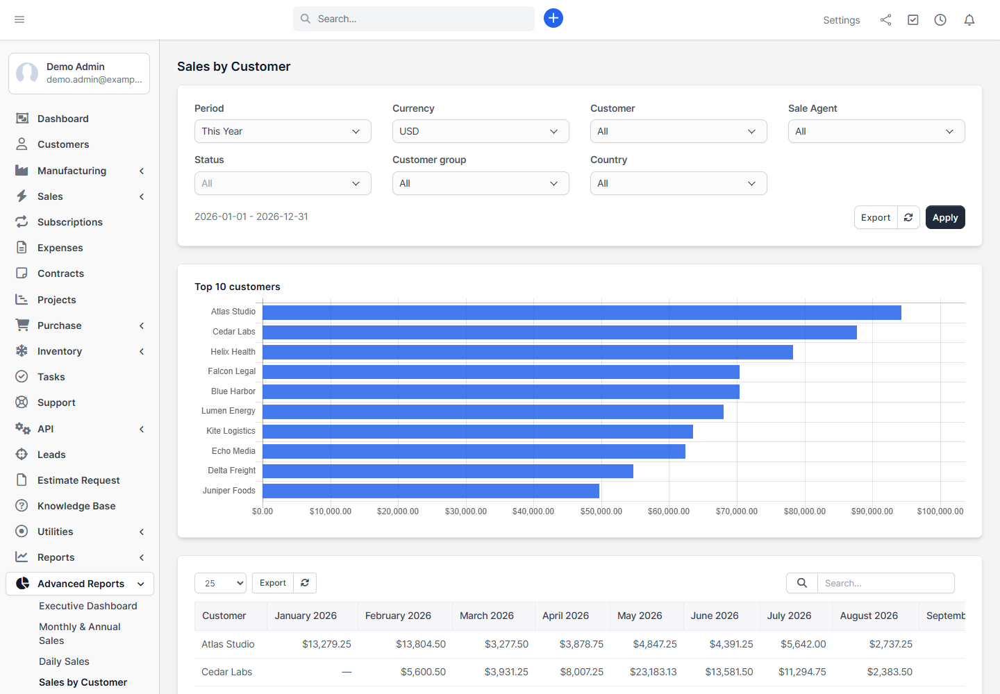
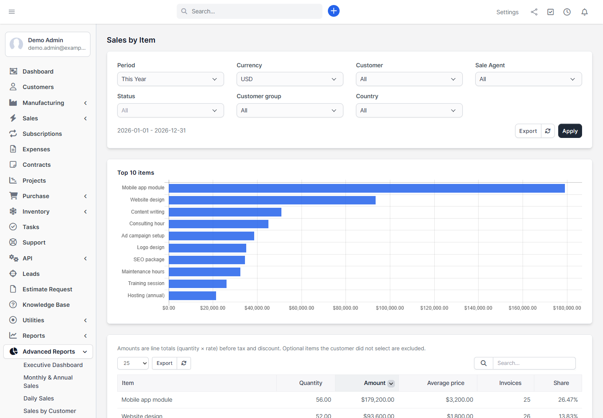
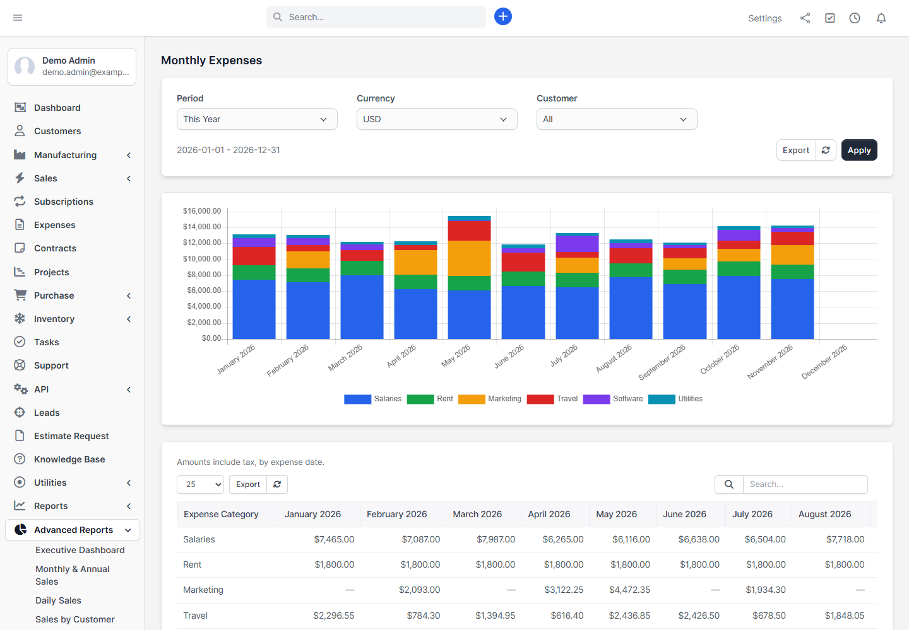
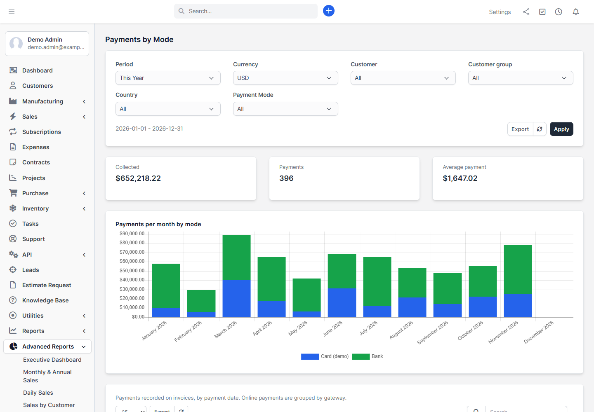

# Advanced Reports Standard for Perfex CRM (free)

**Six sales and finance reports for [Perfex CRM](https://www.perfexcrm.com/), with charts, filters and CSV export. Free for any number of installations.**

  -121833) 

### ⬇️ [Download Advanced Reports Standard](https://www.cloud-hz.com/perfex-modules/advanced-reports/#standard)

Enter your email on the download page and we send you the link right away. No account, no license key.

## The reports

| Report | What it answers |
|---|---|
| **Monthly & Annual Sales** | How much did we invoice each month and year, compared with the same period last year? |
| **Sales by Customer** | Who buys how much, month by month? |
| **Sales by Item** | Which products and services sell, by quantity and amount? |
| **Receivables Aging** | Which unpaid invoices are current, 1–30, 31–60, 61–90 or over 90 days overdue, per customer? |
| **Monthly Expenses** | What do we spend per expense category, month by month? |
| **Payments by Mode** | How much did we receive per payment mode (bank, cash, card…) each month, with every payment listed? |

Every report has:
- currency, customer and period filters, plus sale agent, customer group, country, payment mode or invoice status where they make sense;
- a chart and a sortable, searchable table;
- **CSV export**;
- a shareable link: any filtered view can be bookmarked or sent to a colleague.

## Screenshots

| | |
|---|---|
|  Monthly & Annual Sales |  Sales by Customer |
|  Sales by Item |  Monthly Expenses |
|  Payments by Mode |  Receivables Aging |

Screenshots were taken on our [live demo](https://perfex-demo.cloud-hz.com/admin/), which runs the Pro edition. These six reports look the same in Standard; Pro's extra menu entries are not in Standard.

## Requirements

- Perfex CRM **3.4** or newer
- PHP **8.1** or newer, MySQL 5.7+ / MariaDB 10.3+

The module adds no database tables, needs no license key and never connects to the internet.

## Install

1. [Download the zip](https://www.cloud-hz.com/perfex-modules/advanced-reports/#standard) (do not extract it).
2. In Perfex, log in as an administrator and go to **Setup → Modules**.
3. Choose the zip and click **Install**, then **Activate** next to *Advanced Reports Standard*.
4. An **Advanced Reports** menu appears in the sidebar.

Staff other than administrators need the **View** permission: **Setup → Staff → (member) → Permissions → Advanced Reports Standard**.

## Languages

28 languages, including English, French, Spanish, German, Portuguese, Turkish and **Arabic** (right-to-left), following each staff member's Perfex language.

## Need more? Advanced Reports Pro

[**Advanced Reports Pro**](https://www.cloud-hz.com/perfex-modules/advanced-reports/) has 42 reports: profit and loss, cash flow and forecast, tax summary, daily sales, collections and DSO, projects, staff, inventory, purchasing and manufacturing. It adds an executive dashboard, Perfex dashboard widgets, and Excel and PDF export.

Install Pro whenever you like: Standard steps aside on its own, and your filters and links keep working.

[Live demo](https://perfex-demo.cloud-hz.com/admin/) · [Documentation](https://www.cloud-hz.com/perfex-modules/advanced-reports/docs/) · [Compare Standard and Pro](https://www.cloud-hz.com/perfex-modules/advanced-reports/#standard)

## Français

**Advanced Reports Standard** est un module **gratuit** pour Perfex CRM : ventes mensuelles, ventes par client, ventes par article, balance âgée des créances, dépenses par mois et paiements par mode, avec graphiques, filtres et export CSV. Interface en français. [Télécharger](https://www.cloud-hz.com/fr/perfex-modules/advanced-reports/#standard)

## العربية

**Advanced Reports Standard** وحدة **مجانية** لـ Perfex CRM: المبيعات الشهرية، والمبيعات حسب العميل وحسب الصنف، وأعمار الذمم المدينة، والمصروفات الشهرية، والمدفوعات حسب طريقة الدفع، مع رسوم بيانية وتصفية وتصدير CSV. الواجهة متوفرة بالعربية من اليمين إلى اليسار. [التنزيل](https://www.cloud-hz.com/ar/perfex-modules/advanced-reports/#standard)

## License

Free to use on any number of Perfex CRM installations, for your own business or your clients. You may share the unchanged zip. You may not sell it or share a modified copy under our name. Provided as is, without warranty. Full terms: [cloud-hz.com/license](https://www.cloud-hz.com/license/#advanced-reports-standard). See also [LICENSE.md](LICENSE.md).

## Support

Questions, bug reports and report ideas are welcome: open an [issue](../../issues) or write to **support@cloud-hz.com**.

---

Made by [Horizonsoft](https://www.cloud-hz.com/). Not affiliated with Perfex CRM; Perfex is a trademark of its owner.
